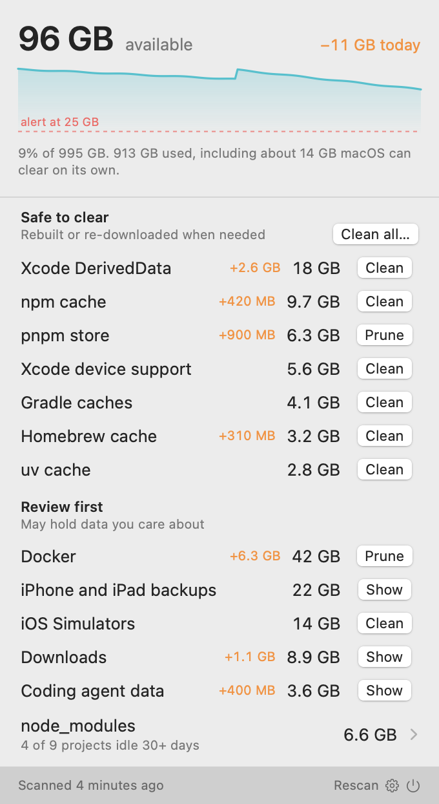
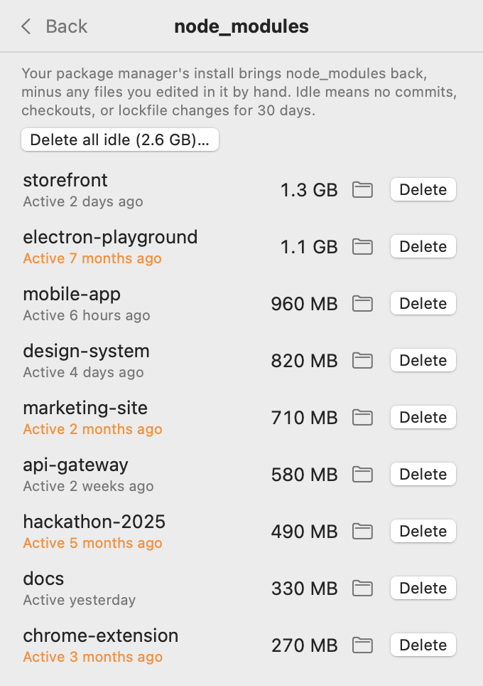

# Headroom

A macOS menu bar app that shows how much disk space you have left, and what's eating it if you're a developer.

<p>
  <picture>
    <source media="(prefers-color-scheme: dark)" srcset="docs/screenshots/panel-dark.png">
    
  </picture>
  &nbsp;
  <picture>
    <source media="(prefers-color-scheme: dark)" srcset="docs/screenshots/node-modules-dark.png">
    
  </picture>
</p>

<sub>Screenshots use made-up data (`--demo`).</sub>

The menu bar shows a small capacity glyph and the percent available. Click it for:

- **Available space** as Finder counts it (including space macOS can purge on its own), with a 7-day trend line, the change over the last 24 hours, and your low-space alert threshold.
- **Safe to clear:** package-manager and build caches that tools rebuild or re-download on demand (npm, pnpm, Bun, Yarn, uv, pip, Gradle, Cargo, Go, Homebrew, CocoaPods, Xcode DerivedData and device support, simulator caches). Each row shows its size and how much it grew since yesterday.
- **Review first:** things that may hold data you care about (Docker, iOS simulators, Xcode archives, device backups, coding agent data, Trash, Downloads), plus `node_modules` folders across your projects, with idle projects marked.
- **Low-space notifications** when available space drops below a threshold (25 GB by default), at most once a day while it stays low.

## Install

Requires macOS 14+ and Xcode (or the Swift toolchain).

```sh
scripts/build-app.sh --install
```

This builds `Headroom.app`, copies it to `~/Applications`, and launches it. On first launch from there it turns on Open at Login; you can turn that off in Settings.

The script signs with your first "Apple Development" identity if you have one (override with `HEADROOM_SIGN_IDENTITY`), otherwise ad hoc. A real identity keeps the signature stable, so macOS remembers Full Disk Access across rebuilds.

### Full Disk Access

Docker's disk image, Trash, Downloads, and device backups live in places macOS protects. Headroom skips them until you grant Full Disk Access (System Settings → Privacy & Security → Full Disk Access → add Headroom), then click **Rescan**. It checks for access without triggering a prompt, so a scan never stalls on a dialog.

## How cleaning works

Every destructive action asks for confirmation inline first. Where a tool has its own cleanup command, Headroom runs it, resolved from your login shell's `PATH` so nvm, Homebrew, and friends are found:

| Category | Action |
| --- | --- |
| npm, Bun, Yarn, uv, pip, Go | the tool's own "clear cache" command |
| pnpm | `pnpm store prune` (keeps packages still in use) |
| Homebrew | `brew cleanup --prune=all` |
| Docker | `docker --context desktop-linux system prune --force` (lists the stopped containers it will delete first; volumes are kept; always Docker Desktop's local engine, never a remote context) |
| iOS Simulators | `xcrun simctl delete unavailable` (lists them first) |
| DerivedData, device support, simulator caches, Gradle, Cargo, CocoaPods, Trash | deletes the folder's contents |
| `node_modules` | deletes the folder, per project or all idle ones |
| Archives, backups, agent data, Downloads | shows the folder in Finder; nothing automatic |

Deletion is restricted to the folders listed in `Sources/HeadroomCore/Catalog.swift` and to folders literally named `node_modules`. After a clean, Headroom reports what the volume actually got back rather than predicting it. APFS clones and shared blocks mean a folder's size isn't always what deleting it frees.

## How measuring works

Sizes are allocated bytes (sparse files like `Docker.raw` count only blocks in use), with hard links counted once and symlinks never followed. A full scan runs in the background every hour, on wake, and on **Rescan**; available space is sampled every minute. History lives in `~/Library/Application Support/Headroom/history.json` and keeps 8 days.

A project counts as idle when none of `.git/index`, `.git/HEAD`, `.git/FETCH_HEAD`, `package.json`, or a lockfile changed within the idle window (30 days by default). The default project folder is `~/github`; add more in Settings.

## Development

```sh
swift build
swift test
scripts/build-app.sh                       # build ./build/Headroom.app without installing
build/Headroom.app/Contents/MacOS/Headroom --debug-window
build/Headroom.app/Contents/MacOS/Headroom --debug-snapshot out.png [--page settings|nodeModules]
```

`--debug-snapshot` renders the panel to a PNG after the first scan and quits, which is handy for checking UI changes without clicking the menu bar. Add `--appearance light|dark` to pick a theme, and `--demo` to show made-up data instead of scanning; demo mode never cleans, saves history, or touches your real settings. `scripts/screenshots.sh` regenerates the README screenshots that way.

Layout: `HeadroomCore` holds everything testable (catalog, measuring, history, alert logic, cleaning, shell). `Headroom` is the SwiftUI app.

## Status

A personal project, shared as is and maintained as time allows. There are no prebuilt or notarized downloads; build it yourself with the script above. Cleaning deletes files, so read the confirmation before you click. See [LICENSE](LICENSE) (MIT).
